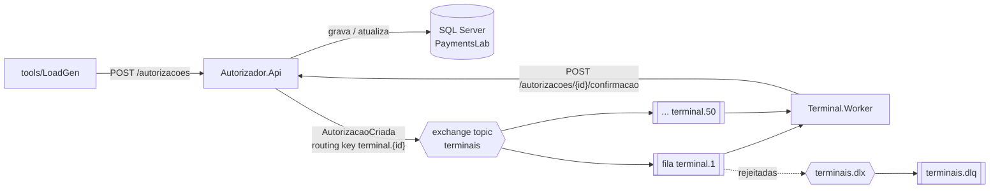

# payments-lab

Laboratório pessoal de estudos de DevOps/Cloud. Simula, de forma **simplificada e fictícia**, um backend
de pagamentos TEF: uma API recebe pedidos de autorização e os entrega a terminais por meio de filas
RabbitMQ (uma fila por terminal). **Não é produção.**

- Nenhum número de cartão (PAN) é aceito ou armazenado: o cartão é sempre um `cartaoToken` (Guid).
- Domínio 100% fictício (bandeiras como "Orbita" e "Cometa" são inventadas).
- Especificação completa em [SPEC.md](SPEC.md).

## Arquitetura



1. `POST /autorizacoes` grava a autorização como **Pendente** e publica `AutorizacaoCriada` na exchange
   `terminais` com routing key `terminal.{terminalId}`. Responde `202 {autorizacaoId}`.
   A mesma `idempotencyKey` sempre devolve o mesmo `autorizacaoId`, sem publicar de novo.
2. O **Terminal.Worker** consome as filas `terminal.{id}` e confirma cada autorização na API.
   O ack só acontece depois que a API respondeu 2xx.
3. A confirmação muda o status para **Confirmada** e publica `AutorizacaoConfirmada` (routing key `confirmacao.{id}`).

| Projeto | O que é |
|---|---|
| `src/Lab.Contracts` | Records das mensagens e nomes da topologia RabbitMQ |
| `src/Autorizador.Api` | ASP.NET Core Minimal API + Dapper; migrations DbUp rodam no startup |
| `src/Terminal.Worker` | `BackgroundService` que consome as filas dos terminais |
| `tools/LoadGen` | Console que gera carga aleatória |
| `deploy/compose` | Docker Compose com tudo |

## Pré-requisitos

- Docker Desktop. **Em Mac Apple Silicon**: *Settings → General → "Use Rosetta for x86_64/amd64
  emulation"* ligado. O SQL Server 2022 não tem imagem ARM64 e roda emulado (`platform: linux/amd64`);
  os demais serviços rodam nativos em ARM64.
- Pelo menos 4 GB de memória para o Docker (*Settings → Resources*).
- .NET 10 SDK, apenas para rodar o LoadGen (ou para desenvolver fora dos containers).
  Alternativa: o Dev Container abaixo, que já traz tudo.

### Dev Container (opcional)

`.devcontainer/` traz um ambiente pronto, nativo em ARM64 no Mac M1: .NET 10 SDK, Docker CLI + Compose
(docker-outside-of-docker), Azure CLI, AWS CLI e GitHub CLI. No VS Code, com a extensão *Dev Containers*:
*Command Palette → "Dev Containers: Reopen in Container"*. Na criação ele roda `dotnet restore`.

- O Docker usado lá dentro é o do Mac (pelo socket): `docker compose up` sobe a stack **ao lado** do
  devcontainer, não dentro dele, e `docker compose ps` mostra os mesmos containers.
- Dentro do devcontainer, `localhost` é o próprio devcontainer. Para falar com a stack use
  `host.docker.internal`, por exemplo:
  `dotnet run --project tools/LoadGen -- --url http://host.docker.internal:8080`.
  No navegador do Mac continua `http://localhost:8080` e `http://localhost:15672`.

## Como subir

```bash
cd deploy/compose
cp .env.example .env      # uma vez; troque as senhas (o .env não vai para o git)
docker compose up --build
```

A ordem de subida é automática, via healthchecks:

```
sqlserver (healthy) ─┐
                     ├─> api (healthy = /health/ready 200) ──> worker
rabbitmq  (healthy) ─┘
```

Na primeira vez o SQL Server leva de 30 a 90 s (emulação). Acompanhe com `docker compose ps`:
todos devem ficar `healthy`, exceto o `worker`, que não expõe HTTP e fica só `Up`.

| Endereço | O quê |
|---|---|
| http://localhost:8080 | Autorizador.Api |
| http://localhost:15672 | RabbitMQ Management (usuário/senha do `.env`) |
| `localhost,1433` | SQL Server (usuário `sa`, senha do `.env`) |

Para parar: `docker compose down`. Para apagar também os dados (banco e filas): `docker compose down -v`.

## Usando a API

```bash
# Criar (202). Repetir com a mesma idempotencyKey devolve o mesmo id.
curl -i -X POST http://localhost:8080/autorizacoes -H 'Content-Type: application/json' -d '{
  "terminalId": 7, "valor": 123.45, "bandeira": "Orbita",
  "cartaoToken": "3f2c1a9e-8b7d-4c6e-9f10-1a2b3c4d5e6f", "idempotencyKey": "pedido-001"
}'

# Consultar: em geral já vem "Confirmada", porque o Worker confirma em milissegundos.
curl http://localhost:8080/autorizacoes/<autorizacaoId>

# Confirmar manualmente (idempotente). O Worker faz isso sozinho.
curl -X POST http://localhost:8080/autorizacoes/<autorizacaoId>/confirmacao
```

Campos fora do contrato (por exemplo `"pan"`) são rejeitados com 400.

### Health checks

| Endpoint | Verifica | Uso |
|---|---|---|
| `GET /health/live` | Só se o processo responde HTTP | liveness: se falhar, reinicie o container |
| `GET /health/ready` | SQL Server (`SELECT 1`, timeout 3 s) e conexão com o RabbitMQ | readiness: pode receber tráfego? 200 ou 503 |

O `/health/ready` responde um JSON com o estado de cada dependência. Para ver o 503:
`docker compose stop rabbitmq`, consulte o ready, depois `docker compose start rabbitmq`.
A API reconecta sozinha em alguns segundos.

## Como gerar carga

Com a stack no ar, a partir da raiz do repositório:

```bash
dotnet run --project tools/LoadGen -- --tps 50 --terminais 50 --duracao 30
```

| Opção | Padrão | Descrição |
|---|---|---|
| `--tps <n>` | 10 | transações por segundo |
| `--terminais <m>` | 50 | sorteia o `terminalId` entre 1 e m |
| `--duracao <seg>` | até Ctrl+C | tempo de execução |
| `--url <url>` | `http://localhost:8080` | URL da API |
| `--concorrencia <n>` | 100 | máximo de requisições em andamento |

A cada segundo o LoadGen imprime quantas requisições terminaram, por classe de status (2xx, 4xx, 5xx,
falhas de rede), e a latência p50/p95/p99. No fim imprime um resumo. Se a API não acompanhar,
"concluídas" fica abaixo do `--tps`.

Use `--terminais` dentro da faixa `TERMINAIS` do Worker. Mensagens para terminais sem fila são
descartadas pelo RabbitMQ e a autorização fica Pendente.

## Chaos: como ligar cada flag

As flags são variáveis de ambiente lidas no startup. Para ligar uma, recrie o serviço passando a
variável (ou coloque-a no `.env`). Para desligar, recrie sem ela. Todos os comandos rodam em `deploy/compose`.

| Variável | Serviço | Padrão | Efeito |
|---|---|---|---|
| `CHAOS_SQL_DELAY_MS` | api | 0 | atraso (ms) dentro de cada query de negócio (`WAITFOR DELAY`), de 0 a 29999 |
| `CHAOS_ERROR_RATE` | api | 0 | fração 0..1 de requisições que recebem 500 |
| `CHAOS_WORKER_PAUSED` | worker | false | declara as filas mas não consome |

### `CHAOS_SQL_DELAY_MS`: banco lento

```bash
CHAOS_SQL_DELAY_MS=200 docker compose up -d api
```

- O `POST /autorizacoes` faz 3 queries, então fica ~600 ms mais lento. Veja o p50 no LoadGen.
- O atraso é um `WAITFOR DELAY` prefixado em cada query do repositório: a espera acontece no
  servidor e aparece na duração do span de SQL (Tópico 1), com o `WAITFOR` visível no `db.query.text`.
- O health check **não** sofre o atraso: o `SELECT 1` do `/health/ready` continua rápido, mesmo com
  valores altos. A lentidão do banco fica visível nos traces, e não na readiness do container.

### `CHAOS_ERROR_RATE`: API instável

```bash
CHAOS_ERROR_RATE=0.3 docker compose up -d api      # use ponto decimal
```

- ~30% das requisições recebem `500` (problem details "Erro simulado"), **antes** de chegar ao endpoint:
  nada é gravado nem publicado. `/health/*` não é afetado.
- O LoadGen mostra os 5xx. O Worker trata 500 como falha transitória e devolve a mensagem para a fila
  (até 5 tentativas). Com taxas altas, algumas mensagens esgotam as tentativas, vão para a
  `terminais.dlq` e a autorização fica Pendente (com 0.3, a chance é 0,3⁵ ≈ 0,24% por mensagem).

### `CHAOS_WORKER_PAUSED`: terminais parados

```bash
CHAOS_WORKER_PAUSED=true docker compose up -d worker
dotnet run --project ../../tools/LoadGen -- --tps 100 --duracao 20
```

- As filas `terminal.*` enchem (veja *Queues* na UI do RabbitMQ) e as autorizações ficam Pendente.
- Volte ao normal com `docker compose up -d worker` e veja as filas esvaziarem.

## Detalhes do Worker

| Variável | Padrão | Descrição |
|---|---|---|
| `TERMINAIS` | `1-50` | filas consumidas; faixa e/ou lista, ex.: `1-10`, `1,2,10-12` |
| `PREFETCH` | 10 | mensagens entregues e ainda sem ack, por terminal |

- Filas **quorum** `terminal.{id}`, com dead letter exchange `terminais.dlx` → fila `terminais.dlq`.
- Um canal por terminal: cada terminal processa uma transação por vez; terminais rodam em paralelo.
- Resultado da confirmação na API:
  - **2xx** → ack.
  - **4xx** → nack sem requeue, a mensagem vai para a DLQ.
  - **5xx, timeout ou API fora** → espera 1 s e devolve à fila; após 5 tentativas, vai para a DLQ.
  No RabbitMQ 4.x um nack com requeue não conta para o `x-delivery-limit`, por isso o Worker
  conta as tentativas pelo header `x-acquired-count`.
- **Shutdown gracioso**: ao receber SIGTERM (`docker compose stop worker`), para de consumir, termina as
  mensagens em voo (até 25 s) e fecha canais e conexão. O que foi entregue e não processado volta para a fila.
  O Compose espera 30 s (`stop_grace_period`) antes do SIGKILL.

Para inspecionar a DLQ: UI do RabbitMQ → *Queues* → `terminais.dlq` → *Get messages*.
O header `x-first-death-reason` diz por que a mensagem foi parar lá.

## Problemas comuns

| Sintoma | Causa provável |
|---|---|
| `sqlserver` sai logo após subir | senha fraca em `MSSQL_SA_PASSWORD` (exige maiúscula, minúscula, número e símbolo) |
| SQL Server muito lento ou travando | Rosetta desligado no Docker Desktop, ou pouca memória |
| `required variable ... is missing` | faltou criar o `.env` (`cp .env.example .env`) |
| Worker loga `PRECONDITION_FAILED` | argumentos das filas mudaram no código; apague as filas `terminal.*` na UI ou rode `docker compose down -v` |
| Autorizações ficando Pendente | Worker pausado, terminal fora de `TERMINAIS`, ou mensagem na DLQ |

## Fora do escopo (por enquanto)

OpenTelemetry, logging estruturado, testes, CI, Kubernetes e Terraform ficam para tópicos futuros da trilha.
